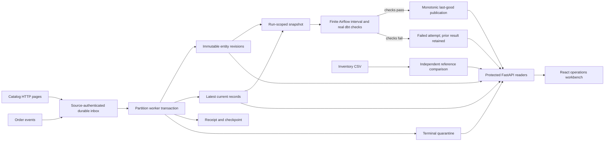

# OrderFlow

OrderFlow is a tenant-scoped event-to-warehouse system with an operations workbench. It accepts durable source events, preserves immutable history, materializes one current record per entity, and publishes reports only after quality checks. It is built and evaluated with synthetic retailer fixtures.

The React interface shows current orders and products, effective price history, an event inbox, source health, terminal quarantine, run checks, last-good reports, and independent inventory differences. The recorded local demonstration includes a real dbt failure that preserves the prior successful report.

## Architecture



PostgreSQL row-level security and server-maintained memberships scope tenant access. A worker commits its revision/current changes, receipt, and checkpoint together. Identical source-event replay returns the existing result; changed content under an existing identity is rejected. Older entity versions stay inspectable without replacing a newer current record. Inventory reconciliation follows a separate path and does not mutate orders or products.

## Native Windows quickstart

Prerequisites: Python **3.12.14**, `uv`, Node.js supported by Vite 8, and PostgreSQL 17 command-line tools. Install the pinned Python interpreter before syncing; an older `uv` release may not have it in its download catalog. If automatic discovery fails, pass its installed executable to `uv sync --frozen --python <path-to-python.exe>`. The recorded environment uses a private PostgreSQL cluster on **127.0.0.1:55449**, with the API on **127.0.0.1:8010**. The bootstrap owns only its marked project cluster and preserves existing data/configuration.

Run from this project directory:

```powershell
uv sync --frozen
.\.venv\Scripts\python.exe scripts\bootstrap.py

Push-Location dashboard
npm ci
npm run build
Pop-Location

.\.venv\Scripts\python.exe scripts\populate_demo.py
powershell -ExecutionPolicy Bypass -File .\scripts\background.ps1 start
```

Open <http://127.0.0.1:8010>. The local identity picker offers Alpha/Beta operator and viewer memberships. Fixture sign-in appears only when the server explicitly enables both local environment and demo mode. Other deployments require a supplied bearer token; an external identity provider is not implemented by this local sign-in.

The bootstrap creates ignored credentials and separate runtime/administrative/transform roles. If PostgreSQL tools are outside `PATH`, set `PG_BIN` to their installation directory before running it. `populate_demo.py` replays reviewed synthetic identities without resetting records. Source keys stay in private runtime files and are never requested by the browser.

Use the owned-process launcher to inspect or stop the API and worker:

```powershell
powershell -ExecutionPolicy Bypass -File .\scripts\background.ps1 status
powershell -ExecutionPolicy Bypass -File .\scripts\background.ps1 stop
```

Stopping these processes preserves the native database. The launcher verifies process ownership rather than terminating arbitrary Python processes.

### Native dbt publication and inventory

Keep dbt in its own Python environment:

```powershell
uv venv .venv-dbt --python 3.12
uv pip install --python .venv-dbt\Scripts\python.exe --require-hashes -r warehouse\requirements-dbt.lock
uv pip check --python .venv-dbt\Scripts\python.exe

.\.venv\Scripts\python.exe scripts\pipeline.py daily --tenant 11111111-1111-4111-8111-111111111111 --source bbbbbbbb-bbbb-4bbb-8bbb-bbbbbbbbbbbb --start 2026-11-22T00:00:00Z --end 2026-11-23T00:00:00Z --oracle fixtures\batch_oracle.json

.\.venv\Scripts\python.exe scripts\pipeline.py inventory --tenant 11111111-1111-4111-8111-111111111111 --source cccccccc-cccc-4ccc-8ccc-cccccccccccc --observed fixtures\inventory_snapshot.csv --reference fixtures\inventory_reference.csv
```

The configured transform login owns the warehouse schema and has bounded run-scoped read access. The app invokes real dbt models/tests before publishing. The original inventory fixture intentionally fails: 20 observed units versus 22 reference units, difference -2. A failed comparison is an inspectable result, not an infrastructure success claim or a healthy zero.

Airflow is a separate Linux environment, not a process inside the continuous worker. Its finite mapped DAG uses an explicit UTC data interval and fails when targets are unconfigured. Installation, manual interval configuration, connector options, and the real failure demonstration are documented in [orchestration/README.md](orchestration/README.md).

## Docker quickstart

Docker Compose provides PostgreSQL, a one-shot initializer, the API, and the worker. The API binds only loopback port 8010. Stop the native API first if it is using that port; native and container databases are separate.

```powershell
.\.venv\Scripts\python.exe scripts\docker_env.py
docker compose --env-file .env.docker up --build -d --wait
```

`docker_env.py` generates ignored local credentials and preserves an existing file. The initialized container fixture exposes the same local workspace at <http://127.0.0.1:8010>. Database and object volumes persist between ordinary restarts.

The optional batch image runs the same finite pipeline CLI with a separate locked dbt environment:

```powershell
docker compose --env-file .env.docker --profile batch run --build --rm batch daily --tenant 11111111-1111-4111-8111-111111111111 --source bbbbbbbb-bbbb-4bbb-8bbb-bbbbbbbbbbbb --start 2026-11-22T00:00:00Z --end 2026-11-23T00:00:00Z --oracle fixtures/batch_oracle.json

docker compose --env-file .env.docker --profile batch run --rm batch inventory --tenant 11111111-1111-4111-8111-111111111111 --source cccccccc-cccc-4ccc-8ccc-cccccccccccc --observed fixtures/inventory_snapshot.csv --reference fixtures/inventory_reference.csv
```

This batch CLI is distinct from scheduling the Airflow DAG. The container stack and real dbt batch have local execution evidence; inspect the recorded artifacts for their exact scope. Stop the Compose services without deleting persistent volumes:

```powershell
docker compose --env-file .env.docker down
```

## Operator workflow

1. **Overview:** inspect current snapshot totals and committed freshness. An order contributes its latest version once; this amount is not cumulative sales. Pending work includes pending and retry-wait events.
2. **Current products/orders:** inspect tenant-scoped keyset pages. Product detail separates raw revisions from curated half-open effective intervals. Dot segments, slashes, Unicode identifiers, large versions, and aggregate minor-unit amounts retain their meaning.
3. **Event inbox/source health:** filter exact states and sources, inspect attempts and integrity hashes, and distinguish durable acceptance from materialization.
4. **Recovery:** only an operator can request a retry, and only for a retry-wait event without a terminal receipt. The UI re-reads an event after an uncertain response before offering another action. A terminal quarantine requires corrected source data under a new event identity/version.
5. **Runs/reports:** inspect the latest attempt separately from the prior successful publication. Staleness can reflect age or a newer failed attempt; no initial success is explicitly represented.
6. **Inventory:** compare independent observed/reference identities, presence flags, and per-SKU quantities. A zero net quantity difference does not prove individual rows match.

Tokens remain in browser memory. Tenant changes immediately remove prior workspace data, cancel reads, and reject delayed responses. Loading, empty, unavailable, expired-session, and retained-prior-view states are explicit. The browser is an inspection client; API authorization and PostgreSQL remain the enforcement boundaries.

## Verification and evidence

Use the current machine-readable reports rather than copying a whole-suite count into documentation. The native and Linux suites are still distinct records; an earlier count is not a claim about a later source revision.

```powershell
.\.venv\Scripts\python.exe scripts\run_tests.py --label windows --junitxml artifacts/checks/full-suite.xml -q
.\.venv\Scripts\python.exe scripts\run_tests.py --label windows --harness acceptance
.\.venv\Scripts\python.exe scripts\run_tests.py --label windows --harness recovery
.\.venv\Scripts\python.exe scripts\run_tests.py --label windows --harness backup

Push-Location dashboard
npm run build
npm run check:format
npm audit
npm run test:browser
npm run test:live
Pop-Location
```

The test runner binds each result to unchanged source, SQL, dependency and fixture bytes; the release manifest requires the matching source-proof files. See [docs/CHECKS.md](docs/CHECKS.md) for Linux runs, release gates and packaging. The independent fixture oracle, process-recovery harness, and backup verifier create only their own fresh databases and verify connected destinations. They do not reset the configured serving database. Pytest uses its configured isolated test destinations. The real browser journey is read-only for domain records; its POSTs are gated fixture sign-ins. Retry UI races are tested separately through intercepted APIs, while backend tests verify actual authorization and transactional effects.

The browser scripts use installed Google Chrome. Video recording additionally needs Playwright's private helper (`npx playwright install ffmpeg` from `dashboard`). See [dashboard/README.md](dashboard/README.md) for frontend details.

Evidence entry points:

| Artifact | Scope |
| --- | --- |
| [artifacts/checks/](artifacts/checks/) | Current pytest/JUnit, independent fixture oracle, recovery, bootstrap, and backup/restore reports |
| [artifacts/pipeline/](artifacts/pipeline/) | Real dbt execution, publication preservation, inventory, and object provenance |
| [artifacts/dashboard/browser-results.json](artifacts/dashboard/browser-results.json) | Built React app with isolated intercepted APIs; source hashes and accessibility states |
| [artifacts/dashboard/live/live-results.json](artifacts/dashboard/live/live-results.json) | Actual HTTP/PostgreSQL browser journeys, video path, observed publication state, and serving preservation |
| [artifacts/security/](artifacts/security/) | Dependency graphs, advisory/source checks, and review evidence |
| [artifacts/ci/](artifacts/ci/) | Local CI-helper proofs; remote workflow results only when actually executed |

The CI workflow is [.github/workflows/acceptance.yml](.github/workflows/acceptance.yml). A committed workflow is configuration; inspect its run evidence before claiming a remote green run. Core/API, pipeline, independent-oracle, recovery, browser, and accessibility counts are different denominators and must not be summed into one quality score.

The recorded v1 benchmark remains historical evidence: its complete10k gate passed, but the100k matrix is not verified. One completed timed workload exceeded the30-minute fixture-token lifetime and failed its final authenticated API assertions; that failed result is preserved. A quota-blocked retry was not replaced with invented evidence. The versioned future harness obtains fresh credentials after timing and requires its own new full gate. See [analysis/README.md](analysis/README.md) for the limitation, separate expiry reproduction, and future v2 commands.

## Scope, hosting, and source visibility

All retailer identities, source records, inventory references, and measured workloads are synthetic. Local and container verification establishes the recorded behavior, not customer adoption, unattended production readiness, or business lift. Automated accessibility scans cover recorded states and do not establish full WCAG conformance.

The backend is not publicly hosted. Optional Neon provisioning is pending owner acceptance of provider terms. The portfolio case study is a separate presentation surface. Objects/manifests are local; injected-client S3 contract tests are not actual AWS execution. A hosted identity-provider deployment and a real merchant integration are outside the recorded local release.

The source repository remains private until owner-approved visibility is verified. Do not commit `.env`, `.env.docker`, `.runtime`, source keys, private backups, tokens, or raw credentials. Public evidence should contain bounded, redacted results rather than machine secrets or private runtime files.
