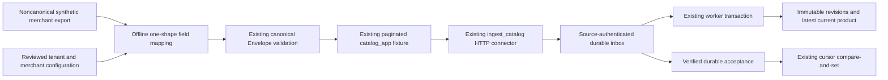

# Customer catalog mapping and acceptance

**Status: synthetic customer exercise, November 23, 2026.** Maple is a fictional merchant and the operator/reviewer roles are automated. No external customer, human acceptance reviewer, production merchant feed or measured business saving is represented here. This is the revised handbook's bounded OrderFlow addition around the existing connector, not a replacement ingestion platform.

The starting source is `b46164173606eb045f11dd05ca8932f49b755ac0` (v0.2.0). Existing HTTP pagination, source authentication, cursor compare-and-set, strict ingress validation, worker transactions, inventory CSV parsing and recovery stay in place. The mapping utility is local/offline; it does not add a hosted endpoint, dependency, database table, billing account or cloud service. See [current deployment boundaries](PRODUCTION.md).

## Operator problem and discovery

The simulated merchant exports product changes with its own column names, decimal-dollar strings and timezone offsets. OrderFlow's existing catalog contract requires canonical event fields, integer minor units and unambiguous instants. Posting the raw export directly would not satisfy that contract. The observed gap at the starting source was the lack of one explicit noncanonical mapping example and acceptance fixture; the source already implemented the canonical ingestion/recovery path.

Three desired outcomes:

1. Map one reviewed external shape into the current envelope without float rounding, inferred timezone or invented event identity.
2. Use the existing paginated HTTP connector so a partially accepted page can resume without duplicate business effects or premature cursor advancement.
3. Retain late revisions while preserving the latest current product; reject identity reuse with changed content and maintain tenant isolation.

The administrator reviews the merchant-to-tenant/source association and owns source credentials. The simulated operator runs the local export mapping; the existing source-authenticated API still enforces its registered tenant/source authority. A human merchant owner and backup incident contact remain prerequisites for an external pilot. No interview, handling-time study or traffic baseline was measured, so productivity savings and adoption remain unclaimed.

## Explicit field map

The [raw export](../fixtures/customer_mapping/maple_catalog.json) has three updates for two products. The [literal expected JSONL](../fixtures/customer_mapping/maple_catalog.expected.jsonl) is a separate fixture oracle, not generated during the assertion. The [one-shape normalizer](../scripts/customer_catalog_mapping.py) emits the existing canonical envelope.

| Merchant field / configured value | Canonical field | Rule |
|---|---|---|
| Reviewed `--tenant` configuration | `tenant_id` | UUID supplied by the operator's reviewed configuration; never trusted from an export's tenant/role field |
| `merchant_code` | Export acceptance condition | Must match the reviewed `--merchant`; the sample uses `maple-demo` |
| `notification_id` | `source_event_id` | Preserve the upstream immutable identity; do not create a new ID for a replay |
| `product_code` | `entity_id`; `partition_key` | Preserve the product identity; call the existing `partition_key("product", id)` helper |
| `revision` | `entity_version` | Existing strict positive integer contract; booleans are not revisions |
| `valid_from` | `effective_at` | Existing RFC3339 parser requires an explicit offset; normalize the instant to UTC |
| `emitted_at` | `occurred_at` | Normalize independently; arrival/emit time does not replace effective time |
| `stock_keeping_unit` | `payload.sku` | Existing nonblank text and length validation |
| `display_title` | `payload.name` | Existing nonblank text and length validation |
| `unit_price` | `payload.unit_price_minor` | Exactly two decimal places in a string, converted with `Decimal`; `"12.30" -> 1230`, `"0.10" -> 10` |
| `currency` | `payload.currency` | This reviewed example accepts USD only; no currency guessing or FX conversion |
| Fixed contract | `schema_version="1"`, `entity_type="product"` | Reuse the existing `Envelope` and canonical serializer |

Unknown root/record fields, the wrong merchant, a timezone-free timestamp, unsupported currency, invalid revision, a floating-point amount, an exponent/grouping separator, extra decimal precision or an amount above the canonical bound fails before any event submission. The input is limited to 1 MiB and 1,000 records; duplicate JSON keys are rejected. Output is deterministic for the same export and reviewed configuration.

The sample deliberately places MAPLE-7 revision 2 before revision 1. The older revision has a later `emitted_at`, demonstrating why neither arrival order nor export order is entity version authority. After materialization, MAPLE-7 remains revision 2 at 1230 minor units, MAPLE-8 remains revision 1 at 10, and all three revisions are inspectable.

## Existing-system path



`catalog_app` is the existing loopback simulator, not a merchant API. The acceptance check exercises actual loopback HTTP and PostgreSQL rather than replacing the connector with mocked success. The mapping is an offline boundary before canonical pagination. It does not fetch a new customer's proprietary API, establish its permissions or claim to translate an arbitrary schema.

No deletion/tombstone, backfill schedule or remote API rate-limit agreement is implied. A real pilot must review those contracts separately. Inventory observed/reference CSV parsing stays on its existing independent path, with no inferred field aliases or relaxed header/quantity validation.

## Acceptance record

The [test file](../tests/test_customer_mapping.py) contains 22 offline boundary/fixture checks and one composite real HTTP/PostgreSQL workflow. These are automated synthetic checks, not human sign-off. The [evidence record](../artifacts/handbook-retrofit-2026-11-23/mapping/README.md) identifies the actual executed run and source hashes.

| Case | Expected | Observed result |
|---|---|---|
| MAP-01 Exact field map | All three outputs match the separate literal canonical fixture, including preserved IDs and UTC instants | Passed in the 22-check offline run |
| MAP-02 Money/config/input boundaries | Invalid precision, float/exponent, currency, timezone, revision, merchant, unknown field, duplicate key or size fails before ingress | Passed in the 22-check offline run |
| MAP-03 Offline handoff CLI | No database/provider call; deterministic JSONL matches the literal fixture | Passed in the 22-check offline run |
| MAP-04 Partial-page interruption | One event durable, old cursor unchanged; resume accepts all three with one duplicate across two pages | **Pass** in the completed source-bound real HTTP/PostgreSQL integration test |
| MAP-05 Explicit complete-feed refresh | Three replays counted as duplicates; original event identity retained; no extra revisions | **Pass** in the completed source-bound real HTTP/PostgreSQL integration test |
| MAP-06 Late revision and isolation | Three historical revisions, latest MAPLE-7 remains v2/1230; Beta has no current rows | **Pass** in the completed source-bound real HTTP/PostgreSQL integration test |
| MAP-07 Changed content under old identity | Existing API rejects it; completed cursor/revision remains unchanged | **Pass** in the completed source-bound real HTTP/PostgreSQL integration test |

## Reproduce and hand off

From the existing checkout and installed project environment, preview the mapping offline:

```powershell
.\.venv\Scripts\python.exe scripts\customer_catalog_mapping.py --input fixtures\customer_mapping\maple_catalog.json --tenant 11111111-1111-4111-8111-111111111111 --merchant maple-demo
```

For the complete acceptance check, configure the repository's **dedicated local test** runtime/admin URLs ending in `orderflow_test`, following [the existing test instructions](CHECKS.md). Then run:

```powershell
.\.venv\Scripts\python.exe -m pytest tests\test_customer_mapping.py -q
```

The imported `core` fixture checks that runtime/admin destinations match and creates/removes a fresh `orderflow_core_test_<uuid>` database for the integration test. It never resets a serving database. If the dedicated test database is unavailable, fix local test configuration; do not substitute production URLs. The full source-bound suite includes this test file through the existing runner/CI commands.

To demonstrate with another explicitly owned local fixture server, save the offline JSONL under ignored local `work/`, then pass it to the existing `scripts/catalog_simulator.py --input ... --page-size 2`. The current `scripts/pipeline.py catalog` command and its private source-key file retain responsibility for ingestion. The hosted browser never receives those keys. Use a new reviewed source namespace for a genuine pilot; these three synthetic identities are not instructions to post fixtures into production.

**Failure interpretation and owner:** mapping rejection belongs to the export/configuration maintainer; do not guess or silently drop a row. An uncertain HTTP acceptance belongs to the connector operator: retain the same event IDs and resume from the unchanged cursor after repairing the dependency. Identity conflict requires a source-owner decision, not changing payload under the same ID or arbitrarily generating a replacement. A terminal business quarantine needs corrected source data under a properly reviewed new identity/version, using the existing recovery rules.

**Feedback-to-fix trace:** the simulated reviewer could follow canonical ingestion but could not show how a merchant's differently named/typed fields reach it. The smallest correction is this one explicit pre-ingress map plus acceptance oracle, not a schema/API rewrite. The normalizer, fixtures and current connector tests demonstrate the corrected handoff. There is no claimed UI usability improvement, operational time saving or customer report behind this finding.

**Rollback and acceptance:** stop feeding the optional local example and retain its input/cursor/receipt evidence; no migration or runtime rollback is needed because the core connector is unchanged. Do not rewind a durable cursor or delete immutable history to undo acceptance. A real merchant's human acceptance owner must independently approve the mapping, currencies/timezones, source authority and failure ownership before enabling that feed. This exercise is not that approval.
